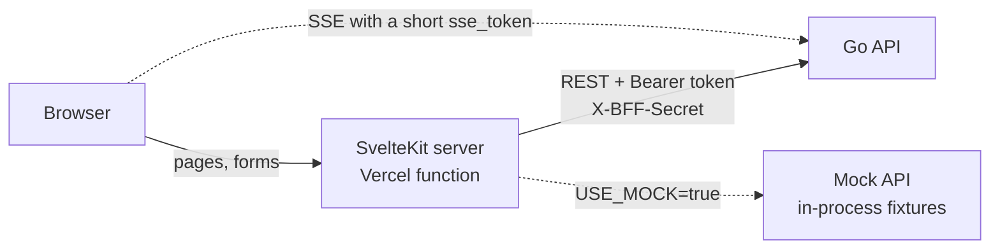
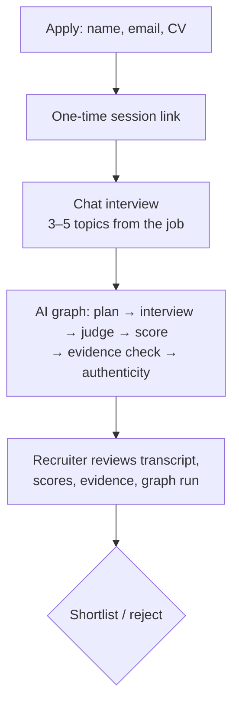

# Talent Scout — Client

The web app for Talent Scout, an AI screening interview. An applicant applies with a CV and takes a short chat interview whose questions come from the job. The AI scores each rubric criterion with quotes from the answers, flags answers that look pasted, and a recruiter makes the decision. The app is SvelteKit with TypeScript, deployed on Vercel, and runs as a **server-side BFF** in front of the Go API ([`talent-scout-server`](https://github.com/aangwijaya/talent-scout-server)).

- **Product spec:** [`docs/PRD.md`](docs/PRD.md)
- **API contract:** [`docs/API.md`](docs/API.md) and [`docs/EVENTS.md`](docs/EVENTS.md). These are copied from the server, so don't edit them here.
- **Visual contract:** [`DESIGN.md`](DESIGN.md). Tokens, components and states; it wins on any visual question.
- **BFF design:** [`docs/SERVER-SIDE.md`](docs/SERVER-SIDE.md)

## What's in it

| Route | Who | What |
|---|---|---|
| `/apply/[jobId]` | Applicant | Job description, plus name, email and a PDF CV (≤ 2 MB). |
| `/s/[token]` | Applicant | The interview: intro, chat with streamed AI replies, thank-you screen. The link is one-time and valid for 7 days. |
| `/dashboard/login` | Recruiter | Single-password sign-in. |
| `/dashboard/jobs` | Recruiter | Jobs list, create and edit jobs with an AI-suggested rubric, open and close jobs. |
| `/dashboard/jobs/[jobId]` | Recruiter | Applicants with status filters, plus the job description and rubric. |
| `/dashboard/applications/[id]` | Recruiter | Transcript, scores with evidence quotes, the answer-authenticity card, the CV, invite link, and shortlist or reject. |
| `/dashboard/runs/[runId]` | Recruiter | The AI graph run, live or replayed: nine nodes, retries, checks, cost. |

## How it works



- **The browser never sees a token.** The recruiter token lives in an httpOnly cookie, and `hooks.server.ts` guards `/dashboard/*` and attaches the token only to API calls.
- **Server loads and form actions** call the Go API through `src/lib/server/api`.
- **Live streams** (the interview chat and the graph run) are the one exception. The browser opens `EventSource` straight to the Go API with a ~60 s, run-scoped `sse_token` that the server mints.
- **All configuration is private, server-side env.** There are no `PUBLIC_*` variables.
- **Mock mode:** `USE_MOCK=true` swaps in an in-process mock API built from fixtures and recorded graph runs. Every page works with no server.

More detail, including the threat model and the reasons for each choice, is in [`docs/SERVER-SIDE.md`](docs/SERVER-SIDE.md).

### The applicant and recruiter flow



## Run it locally

**Prerequisites:**
- Node 24.
- pnpm 12.18, through Corepack (`corepack enable` picks up `packageManager` from `package.json`).

### 1. Mock mode (no server, the quickest)

```bash
pnpm install
cp .env.example .env        # USE_MOCK=true is the default
pnpm dev                    # http://localhost:5173
```

- **Recruiter:** open `/dashboard/login`. The mock password is `MOCK_PASSWORD` in `src/lib/server/api/fixtures/index.ts`; it only works in mock mode.
- **Applicant:** use a job's apply link from the jobs page, or open a session link from an application's "Get invite link".

### 2. Against the real Go API

1. Start the server locally by following the server README's "Run locally" section. Use `LLM_MODE=fake` and `EMAIL_MODE=log` if you don't want real model calls or email.
2. In this repo's `.env`:
   - `USE_MOCK=false`
   - `API_BASE_URL=http://localhost:8080`, or wherever the server listens.
   - `BFF_SHARED_SECRET` set to the **same** value as the server's. For local use, make one with `openssl rand -base64 32`, and never reuse the production one.
3. On the server, `FRONTEND_ORIGIN` must include this app's origin (`http://localhost:5173`), so the browser's SSE connections pass CORS.
4. Run `pnpm dev`. The recruiter password is the server's `RECRUITER_PASSWORD`.

### Environment variables

All are private (`$app/env/private`, declared in `src/env.ts`). Copy [`.env.example`](.env.example) and **never commit `.env`**.

| Name | Purpose |
|---|---|
| `USE_MOCK` | `true`: in-process mock API, with no network. `false`: the real Go API. |
| `API_BASE_URL` | Base URL of the Go API. Also used as the SSE base URL returned to the browser. |
| `BFF_SHARED_SECRET` | Sent as `X-BFF-Secret` so the server trusts the forwarded applicant IP for rate limiting. Must match the server. |
| `DEMO_PASSWORD` | Public demo only. Shows the recruiter password on the login page and a notice on the apply page. Leave it empty elsewhere. |

## Scripts

| Command | What it does |
|---|---|
| `pnpm dev` | Dev server with hot reload. |
| `pnpm build` / `pnpm preview` | Production build (`adapter-vercel`), and a local preview of it. |
| `pnpm check` | `svelte-check` type checking. |
| `pnpm lint` / `pnpm format` | Prettier and ESLint check, or Prettier write. |
| `pnpm test` | Unit and component tests (Vitest). |
| `pnpm test:e2e` | Playwright against a production build in mock mode, plus a fake API (`tests/e2e/fake-api.ts`). |
| `pnpm gen:api` | Regenerates `src/lib/server/api/schema.d.ts` from the vendored `openapi.yaml`. |

## Tests and CI

GitHub Actions runs three jobs on every PR (`.github/workflows/ci.yml`):
- **`checks`:** `pnpm check`, `lint`, `test`, `build` and `test:e2e`, in mock mode with the fake API.
- **`integration`:** checks out the server at the commit pinned in `contract.lock`, starts the real Go server (fake LLM, fake storage, log-only email), and runs the Playwright `integration` project against it, three times.
- **`contract`:** checks that `docs/API.md`, `docs/EVENTS.md`, `docs/PRD.md` and the vendored `openapi.yaml` match the hashes in `contract.lock`.

## The API contract

The server repository is the source of truth for the contract. `contract.lock` pins a server commit and the file hashes, so a server change never turns an unrelated client PR red. When the server's contract moves, a sync PR updates the copies, regenerates `schema.d.ts` and bumps the lock. Change the contract on the server first, never here.

## Deploy (Vercel)

- The project uses `@sveltejs/adapter-vercel`. Set `USE_MOCK=false`, `API_BASE_URL`, `BFF_SHARED_SECRET` and, for a public demo, `DEMO_PASSWORD` as **environment variables in the Vercel project settings**. They stay server-side.
- The server's `FRONTEND_ORIGIN` must list the Vercel domain for SSE.
- SSE goes from the browser straight to the Go API and is never proxied through a Vercel function. Functions are cut at 300 s.

## Security notes

- No secrets in the repository. `.env` is git-ignored, and every value lives in the environment.
- The recruiter token is only ever in an httpOnly, `sameSite=lax` cookie. Load and action data never return tokens.
- `handleError` logs without tokens or query strings and shows a generic message.
- The applicant CV is uploaded through a form action (validated ≤ 2 MB PDF) and is downloadable only by the recruiter, through the server.

## How this repo is built

The code in this repo is written by an AI coding agent (Claude Code). It works one GitHub issue (a "node") at a time, with a list of paths it may change, its tests written first, and code checks before every PR. An independent reviewer and a verifier check every PR, and a human merges it. Project knowledge for agents is in [`CLAUDE.md`](CLAUDE.md) and [`docs/LESSONS.md`](docs/LESSONS.md).
