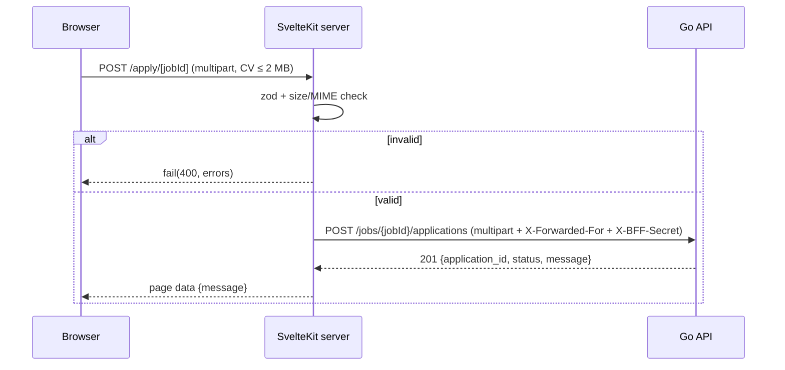
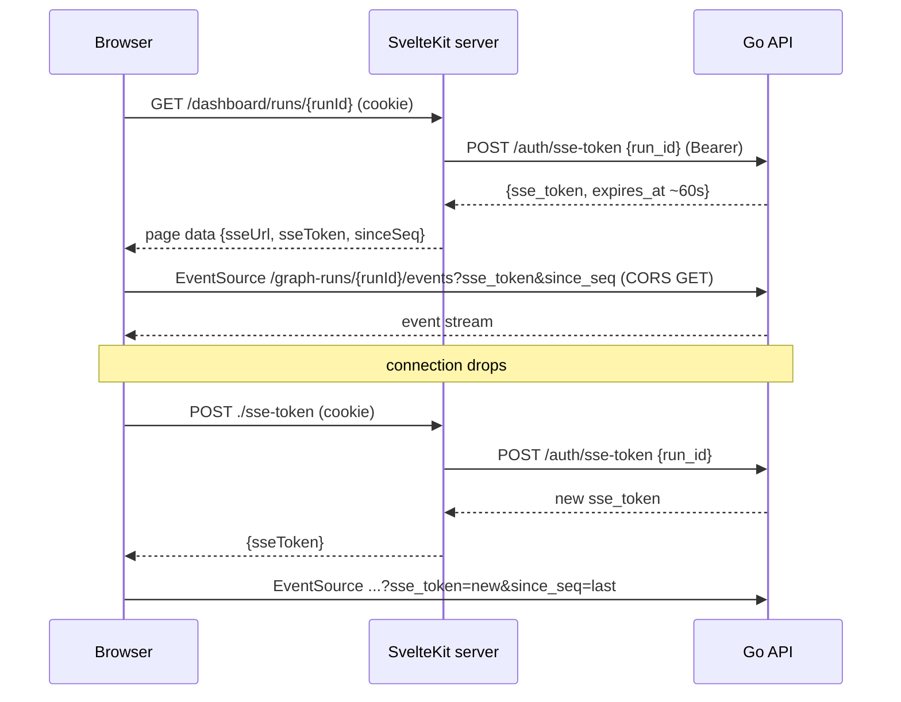

# Server-side SvelteKit (BFF) — design & flow

> Status: **approved 2026-11-05**. The contract part is tracked in server [#18](https://github.com/aangwijaya/talent-scout-server/issues/18) (`contract-change`) and already reflected in `docs/API.md` / `docs/EVENTS.md`; if this page and the contract docs ever disagree, the contract docs win. Implementation issues are listed under "Tracking issues" at the end.

## Flow at a glance

1. The browser only talks to the SvelteKit server (Vercel function) — never to the Go API — except for SSE streams.
2. Recruiter submits the password to the `login` form action → server calls Go `POST /auth/login` → sets an **httpOnly** `ts_session` cookie (`maxAge` from `expires_at`, 12 h). The token is never returned to the browser.
3. `hooks.server.ts` `handle` reads the cookie into `locals.recruiter` and redirects `/dashboard/*` (except login) to `/dashboard/login?redirectTo=…` (303) if missing/expired.
4. `+page.server.ts` loads/actions call the Go API through `src/lib/server/api` with private env `API_BASE_URL`; `handleFetch` adds `Authorization: Bearer` only for that host.
5. Go returns 401 → server deletes the cookie and redirects to `/dashboard/login`.
6. `USE_MOCK=true` (private env) swaps the real API client for the mock implementation on the server; pages don't know which one they get.
7. Applicants: `/apply/[jobId]` uploads the CV through a form action (zod + size/MIME check, ≤ 2 MB) → Go; `/s/[token]` loads/sends chat via server.
8. SSE exception: the server load mints a ~60 s, run-scoped `sse_token` (Go `POST /auth/sse-token`); the browser opens `EventSource` directly to Go with `sse_token` + `since_seq`; on reconnect it fetches a fresh token from a small `+server.ts` endpoint. Go allows CORS only on SSE `GET` routes (origins from `FRONTEND_ORIGIN`).
9. Applicant IP: on Go API calls the SvelteKit server sends `X-Forwarded-For: <event.getClientAddress()>` plus `X-BFF-Secret: <BFF_SHARED_SECRET>`; Go trusts that IP for the 5/IP/hour rate limit only when the secret matches.
10. Logout = form action that deletes the cookie (token is stateless, no server call).

## Why server-side instead of a static SPA

- **Token never in JS.** An httpOnly cookie is not readable by XSS; `sessionStorage` is.
- **Secrets & base URL stay private.** No `PUBLIC_*` env; the Go API URL and mock switch are server-only.
- **One place for auth, errors, redaction** (`hooks.server.ts`), instead of per-page browser code.
- **Progressive forms.** Form actions + `fail()` give validation errors without client fetch boilerplate.
- Matches the team's existing practice (reference codebase: `eb-bo-web`, SvelteKit + adapter-node).

## Lessons from the reference codebase (eb-bo-web)

### Patterns to mirror

- Auth module with an auth `handle` in `hooks.server.ts` that populates `event.locals` (user, isAuthenticated).
- `requireAuth(event)` guard, redirecting 303 to the login page with `?referer=` (we call it `?redirectTo=`), sanitised by `normalizeRefererPath` (prevents open redirects). The reference runs it in `+layout.server.ts`; we run it in `handle` (see lesson 5 below).
- Cookie manager: `httpOnly`, `secure` in production, `sameSite: 'lax'`, `path: '/'`.
- Form actions: `request.formData()` → zod `safeParse` → `fail(400, { errors: z.flattenError(...) })`.
- Typed API client + endpoint map, called with `event.fetch`; private env via `$app/env/private`.
- Upload action: rebuild `FormData` on the server and forward to the API with server-held credentials.
- Logout as a server-side action/load that clears the session.
- Unit tests per auth module (hook, guards, cookies, redirects).

### Lessons — things to do differently

1. **Never return tokens in `load` or action data.** Anything returned from `load`/actions is serialised into the page and readable by JS, which cancels the httpOnly protection.
2. **No endpoint that accepts tokens from the client and writes them into cookies.** That enables session fixation; only the login action sets the session cookie, from the Go response.
3. **A proxy must not forward the browser's `Authorization` header.** The browser shouldn't hold a token at all; the server attaches it from the cookie.
4. **No debug `console.log` of API responses, and define `handleError`** to log safely (no tokens, no query strings) and return a generic message.
5. **Don't rely on a layout guard.** A `+layout.server.ts` guard doesn't cover form actions or `+server.ts`, and a page load can still run while it redirects. Guard in `handle` instead.

## Talent Scout design

### Adapter & Vercel Hobby limits

- `@sveltejs/adapter-vercel`; remove `ssr = false`, `fallback: 'index.html'` and the `vercel.json` SPA rewrite.
- Vercel Functions (Hobby, Fluid compute, checked 2026-11-05 at https://vercel.com/docs/functions/limitations):
  - Max duration **300 s** (default = max).
  - Request/response body **4.5 MB** (413 `FUNCTION_PAYLOAD_TOO_LARGE` above it).
- Consequences: a 2 MB CV through a form action fits (validate ≤ 2 MB in the action; Go keeps its own limit). **Don't proxy SSE through a function** (cut at 300 s, burns active CPU).
- The free `*.vercel.app` subdomain is still fine.

### Server layout

```
src/
├── hooks.server.ts            # handle (session → locals.recruiter), handleFetch, handleError
├── lib/server/
│   ├── session.ts             # cookie name/options, set/clear, read
│   ├── guards.ts              # requireRecruiter(event), normalizeRefererPath
│   └── api/
│       ├── index.ts           # export const api = USE_MOCK ? mockApi : realApi
│       ├── types.ts           # interface TalentScoutApi
│       ├── real.ts            # getRequestEvent().fetch → API_BASE_URL
│       └── mock.ts            # fixtures
└── routes/
    ├── dashboard/login/+page.server.ts          # login action
    ├── dashboard/logout/+page.server.ts         # logout action
    ├── dashboard/(recruiter)/                   # jobs, applications, runs (guarded by handle)
    ├── dashboard/(recruiter)/runs/[runId]/+page.server.ts         # load mints sse_token
    ├── dashboard/(recruiter)/runs/[runId]/sse-token/+server.ts    # POST: reconnect mint
    ├── apply/[jobId]/+page.server.ts  # job load + apply action
    └── s/[token]/+page.server.ts      # session load + message action
```

### Auth

- `login` action: zod `{password}` → Go `POST /auth/login` → on 200 set cookie `ts_session=<access_token>`: `httpOnly`, `secure` (prod), `sameSite: 'lax'`, `path: '/'`, `maxAge = expires_at − now`. 401 → `fail(401, { formErrors: ['Wrong password'] })`. Then `redirect(303, normalizeRefererPath(redirectTo) ?? '/dashboard/jobs')`.
- No refresh logic (Go token is stateless, 12 h, no refresh).
- `handle`: read cookie → `locals.recruiter = { token, expiresAt }` or `null`; expired → delete cookie. For `/dashboard/*` except login: no `locals.recruiter` → `redirect(303, '/dashboard/login?redirectTo=' + path)`. This also covers form actions and `+server.ts`.
- Loads may return `{ recruiter: { expiresAt } }` — **never the token**.
- `handleFetch`: add `Authorization: Bearer <token>` only when the request URL starts with `API_BASE_URL`.
- `handleError`: log status + route id, redact tokens/query strings, return `{ message: 'Something went wrong' }`.
- Go 401 in any load/action → clear cookie → `redirect(303, '/dashboard/login?redirectTo=…')`.
- `logout` action: delete cookie → redirect `/dashboard/login`.

### Env

| Name | Scope | Purpose |
|---|---|---|
| `API_BASE_URL` | `$app/env/private` | Go API base URL (server only) |
| `USE_MOCK` | `$app/env/private` | `true` → mock implementation |
| `BFF_SHARED_SECRET` | `$app/env/private` | Sent as `X-BFF-Secret` with the forwarded applicant IP; same value as on the Go server |

`PUBLIC_API_BASE_URL` and `PUBLIC_USE_MOCK` are removed. The SSE base URL is returned from the server load (it's not secret, just not a `PUBLIC_*` build constant).

### Mock mode

`src/lib/server/api/types.ts` defines one `TalentScoutApi` interface; `real.ts` and `mock.ts` implement it; `index.ts` picks one from `USE_MOCK`. `real.ts` gets the request through `getRequestEvent()`, so `api` can stay a singleton and `handleFetch` still runs. Replay data the browser needs lives in `src/lib/mock/`, because `$lib/server` can't be imported from browser code. Loads/actions import only `api` from `$lib/server/api`. Tests mock that module.

### SSE exception

- New Go endpoint **`POST /auth/sse-token`** (Bearer) with body `{ run_id }` → `{ sse_token, expires_at }`, ~60 s, HMAC-signed with claims `aud=sse`, `run_id`.
- Graph-run page load mints the token and returns `{ sseUrl, sseToken, sinceSeq }`.
- Browser: `new EventSource(`${sseUrl}/graph-runs/${runId}/events?sse_token=…&since_seq=…`)`.
- Go validates `sse_token` only on SSE routes, at connect time (an open stream isn't cut when the token expires).
- Reconnect: on `error`, close, `fetch('./sse-token', { method: 'POST' })` (cookie-authenticated `+server.ts`, returns a fresh token), reopen with the last `since_seq`.
- **CORS (Go):** allowlist from the existing env `FRONTEND_ORIGIN` (comma-separated: prod domain, preview URL(s), `http://localhost:5173`; no new variable), only `GET` on SSE routes, no `Allow-Credentials`. Other routes need no CORS (called server-to-server). Never log the query string.
- Applicant SSE `GET /sessions/{token}/events` is already public by path token → direct connection with CORS only.
- Alternative (not recommended): proxy SSE through a `+server.ts` — only viable for runs < 300 s.

### Applicant flows

- `/apply/[jobId]`: load fetches the job via `GET /jobs/{jobId}/public` (404 → error page). `apply` action: zod fields + CV check (≤ 2 MB, `application/pdf` / allowed MIME) → forward multipart to Go `POST /jobs/{jobId}/applications` → show the returned `message`. Go errors (`invalid_file`, 413 `file_too_large`, 409 `already_applied`, 429 `rate_limited`) → `fail(4xx)` with a friendly message.
- **Trusted client IP (approved):** Go limits 5 applies/IP/hour, but behind the BFF every request comes from Vercel's IPs. So the server API client sends `X-Forwarded-For: <event.getClientAddress()>` and `X-BFF-Secret: <BFF_SHARED_SECRET>` (private env, same value on Vercel and Railway). Go compares the secret in constant time; match → use the first XFF address as the client IP; no match / missing secret / unset env → ignore XFF and use the TCP peer address. The secret is never logged or returned. Implemented in server [#21](https://github.com/aangwijaya/talent-scout-server/issues/21) and client [#15](https://github.com/aangwijaya/talent-scout-client/issues/15).
- `/s/[token]`: load validates the session token via Go (404 → error page); `message` action posts the chat message. SSE as above (public path token). No cookie needed.

## Sequence diagrams

### Recruiter login + page load

```mermaid
sequenceDiagram
  participant B as Browser
  participant K as SvelteKit server
  participant G as Go API
  B->>K: POST /dashboard/login (password)
  K->>G: POST /auth/login {password}
  G-->>K: 200 {access_token, expires_at}
  K-->>B: 303 /dashboard/jobs + Set-Cookie ts_session (httpOnly)
  B->>K: GET /dashboard/jobs (cookie)
  K->>K: handle → locals.recruiter; guard OK
  K->>G: GET /... (handleFetch adds Bearer)
  alt 200
    G-->>K: data
    K-->>B: HTML + page data (no token)
  else 401
    G-->>K: 401
    K-->>B: 303 /dashboard/login?redirectTo=/dashboard/jobs (cookie cleared)
  end
```

### CV apply upload



### SSE token mint + connect + reconnect



## Tracking issues

Approved 2026-11-05. Server (`aangwijaya/talent-scout-server`):

- [#18](https://github.com/aangwijaya/talent-scout-server/issues/18) contract-change: `POST /auth/sse-token`, `sse_token` on run SSE, CORS section, trusted client IP (human approval)
- [#19](https://github.com/aangwijaya/talent-scout-server/issues/19) SSE token endpoint + `sse_token` auth + query-string log redaction
- [#20](https://github.com/aangwijaya/talent-scout-server/issues/20) CORS on SSE `GET` routes only (`FRONTEND_ORIGIN`)
- [#21](https://github.com/aangwijaya/talent-scout-server/issues/21) trusted client IP from the BFF (`BFF_SHARED_SECRET`)
- Updated: #5 (header-only bearer), #6 (rate limit uses #21), #13 (`sse_token`), #15 (`BFF_SHARED_SECRET` on Railway)

Client (`aangwijaya/talent-scout-client`):

- [#13](https://github.com/aangwijaya/talent-scout-client/issues/13) auth hooks + `ts_session` cookie + `(recruiter)` guard
- [#14](https://github.com/aangwijaya/talent-scout-client/issues/14) SSE token mint + reconnect
- [#15](https://github.com/aangwijaya/talent-scout-client/issues/15) applicant IP forwarding
- Updated: #1 (adapter-vercel), #3 (`src/lib/server/api`), #4–#11 (server loads/actions, cookie auth, `USE_MOCK`, Vercel env)

Unaffected: `DESIGN.md`, `use-design-tokens`.
